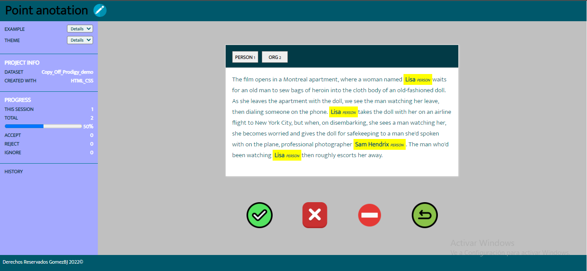
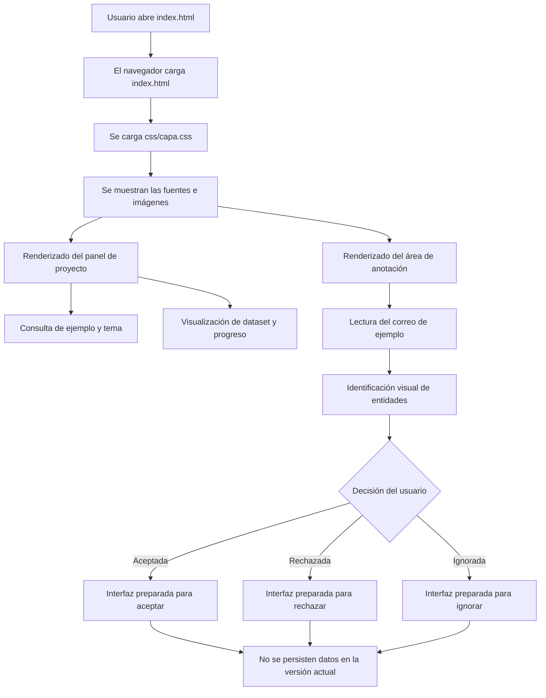

# Point Anotation

**Point Anotation** es una maqueta de interfaz para la anotación manual de correos electrónicos destinada a crear datos de entrenamiento para aplicaciones de Inteligencia Artificial.

El proyecto muestra una vista inspirada en herramientas de anotación como Prodigy: un panel lateral con información y progreso, y un área principal para revisar el texto y aplicar etiquetas como `PERSON` u `ORG`.

> Actualmente se trata de un prototipo estático creado con HTML y CSS. Los valores, etiquetas y botones se muestran como interfaz demostrativa y todavía no guardan ni procesan datos.

## Características

- Interfaz dividida en panel de proyecto y área de anotación.
- Selector de ejemplo y tema visual.
- Información del dataset y tecnología utilizada.
- Indicador de progreso de la sesión.
- Contadores de muestras aceptadas, rechazadas e ignoradas.
- Texto de correo con entidades resaltadas.
- Etiquetas para personas y organizaciones.
- Diseño adaptable mediante CSS Grid y media queries.

## Vista previa



Más ejemplos visuales están disponibles en [`screenshot/`](screenshot/).

## Tecnologías

- HTML5
- CSS3
- CSS Grid
- Google Fonts
- Recursos gráficos externos

No requiere frameworks, gestores de paquetes ni dependencias adicionales.

## Uso

### Requisitos

- Un navegador web moderno.
- Conexión a Internet para cargar las fuentes de Google y las imágenes externas.

### Ejecutar localmente

1. Clona el repositorio:

```bash
git clone https://github.com/Gomezbj/point-anotation.git
cd point-anotation
```

2. Abre el proyecto con cualquiera de estas opciones:

```bash
# Opción 1: abrir directamente
open index.html
```

O inicia un servidor local:

```bash
python3 -m http.server 8000
```

Después, visita:

```text
http://localhost:8000
```

También puedes abrir `index.html` directamente desde el navegador.

### Interacción actual

1. Selecciona el tipo de ejemplo en **EXAMPLE**.
2. Elige una apariencia en **THEME**.
3. Consulta la información del proyecto y el progreso.
4. Revisa las entidades resaltadas en el correo.
5. Utiliza los controles visuales para representar la decisión de anotación.

## Diagrama de flujo



## Flujo de datos

En esta versión no existe persistencia ni lógica de backend:

```text
index.html
    ├── estructura de la interfaz
    ├── texto de ejemplo
    ├── controles HTML
    └── enlaces a css/capa.css

css/capa.css
    ├── estilos generales
    ├── panel lateral
    ├── área de anotación
    └── reglas responsive
```

## Estructura del proyecto

```text
point-anotation/
├── index.html        # Página principal y estructura visual
├── css/
│   └── capa.css      # Estilos, diseño responsive y componentes
├── screenshot/       # Capturas de la interfaz
└── README.md         # Documentación del proyecto
```

## Posibles mejoras

- Añadir JavaScript para guardar anotaciones.
- Conectar un backend y una base de datos.
- Cargar datasets desde JSON o CSV.
- Permitir crear, editar y eliminar etiquetas.
- Calcular automáticamente el progreso.
- Exportar las anotaciones en formato JSON, JSONL o CSV.
- Añadir autenticación y perfiles de usuarios.
- Incorporar accesibilidad mediante navegación por teclado y etiquetas ARIA.
- Eliminar recursos remotos para permitir una ejecución completamente local.

## Autor

**GomezBJ** — [https://gomezweb.netlify.app](https://gomezweb.netlify.app)

## Licencia

Este repositorio no incluye actualmente un archivo de licencia. Antes de reutilizar el proyecto con fines comerciales o redistribuirlo, contacta al autor para aclarar las condiciones de uso.
